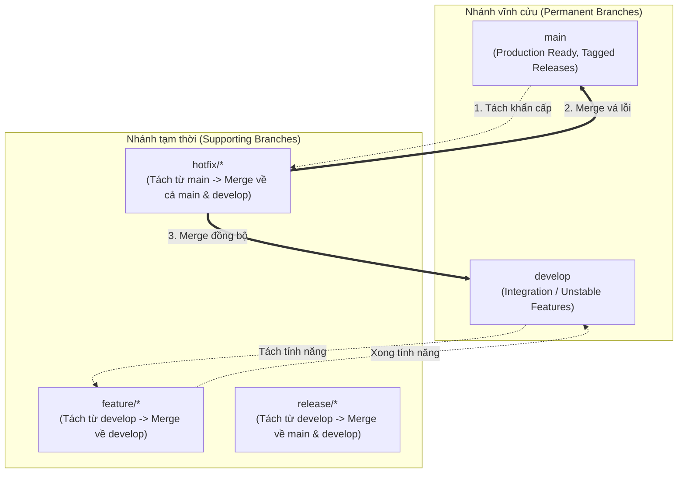

# BÀI TẬP 4: MÔ PHỎNG QUY TRÌNH HOTFIX & GITFLOW THỰC TẾ

**Mã bài tập:** SESSION 05 - EXERCISE 4 (`homework/session_05/ex4/`)  
**Môn học:** IT215 - Cloud Infrastructure & DevOps Fundamentals  
**Học viên:** Trần Đức Anh (`TranDucAnh3103`)  
**Email:** `TranDucAnh3103@users.noreply.github.com`  
**Hệ điều hành / Môi trường:** Windows 11 Single Language (26H2) / PowerShell 7+ / Git for Windows v2.47+  
**Đường dẫn thư mục dự án:** `f:/CNTT/Rikkei/IT215/ss05/ex4/`  

---

## 1. MỤC TIÊU BÀI TẬP

1. **Ứng dụng mô hình Gitflow chuẩn trong sản xuất (Production Gitflow):** Hiểu rõ vai trò và vòng đời của hai nhánh vĩnh cửu (`main`, `develop`) cùng các nhánh bổ trợ (`hotfix/*`, `feature/*`, `release/*`).
2. **Quy trình ứng phó sự cố khẩn cấp (Hotfix Management):** Khi môi trường production (nhánh `main` phiên bản `v1.0.0`) gặp lỗ hổng bảo mật nghiêm trọng (lộ dữ liệu người dùng), lập tức cô lập sự cố bằng nhánh `hotfix/v1.0.1` được tách trực tiếp từ `main`.
3. **Độc lập triển khai (Isolated Deployment):** Đảm bảo bản vá lỗi được đẩy lên production mà **không bị lẫn mã nguồn dở dang** từ nhánh phát triển (`develop`).
4. **Quy trình gộp 2 chiều bắt buộc (Bi-directional Merge):** Sau khi sửa lỗi xong, phải gộp vào `main` (tạo tag release `v1.0.1`), đồng thời **bắt buộc phải gộp ngược lại nhánh `develop`** để ngăn chặn lỗi bị tái phát (Regression / Bug Drift) trong các bản phát hành tương lai.
5. **Dọn dẹp tài nguyên (Branch Lifecycle Hygiene):** Xóa bỏ nhánh hotfix cục bộ sau khi hoàn thành tích hợp.

---

## 2. BẢNG TỔNG HỢP TIẾN TRÌNH THỰC HIỆN & KẾT QUẢ KIỂM TRA

| STT | Bước thực hiện | Nhánh thao tác | Lệnh Git thực hiện | Ý nghĩa kỹ thuật | Kết quả ghi nhận | Trạng thái |
| :---: | :--- | :---: | :--- | :--- | :--- | :---: |
| 1 | Khởi tạo release v1.0.0 | `main` | `git commit; git tag -a v1.0.0` | Xuất bản phiên bản production đầu tiên | Commit `9c90a99`, Tag `v1.0.0` | **PASSED** |
| 2 | Rẽ nhánh phát triển | `develop` | `git checkout -b develop` | Tách môi trường tích hợp tính năng tương lai | Nhánh `develop` được tạo từ `main` | **PASSED** |
| 3 | Phát triển tính năng dở dang | `develop` | Commit `chat.js`, `notification.js` | Tạo 2 commit tính năng v1.1.0 (`61fc238`, `52bf652`) | `develop` đi trước `main` 2 commit | **PASSED** |
| 4 | Phát hiện sự cố bảo mật | `main` | `git checkout main` | Quay lại nhánh production để xử lý sự cố | Phát hiện bug lộ hash & ssn | **PASSED** |
| 5 | Tách nhánh Hotfix | `hotfix/v1.0.1` | `git checkout -b hotfix/v1.0.1` | Tách trực tiếp từ đỉnh của `main` (không qua develop) | Nhánh hotfix sẵn sàng | **PASSED** |
| 6 | Thực hiện bản vá | `hotfix/v1.0.1` | Sửa `server.js` & commit | Làm sạch dữ liệu, loại bỏ `password_hash` và `ssn` | Commit `84f1ca7` | **PASSED** |
| 7 | Merge vào nhánh `main` | `main` | `git merge --no-ff hotfix/v1.0.1` | Áp dụng bản vá cho production ngay lập tức | Merge commit `fe965cb` | **PASSED** |
| 8 | Tạo Release Tag | `main` | `git tag -a v1.0.1 -m "..."` | Đánh dấu mốc phát hành bản vá nóng | Tag `v1.0.1` trỏ vào `fe965cb` | **PASSED** |
| 9 | Merge ngược vào `develop` | `develop` | `git merge --no-ff hotfix/v1.0.1` | Đồng bộ bản vá cho luồng phát triển tương lai | Merge commit `b9f4ee2` | **PASSED** |
| 10 | Xóa nhánh Hotfix | `main`/`develop` | `git branch -d hotfix/v1.0.1` | Dọn dẹp nhánh tạm thời hoàn thành nhiệm vụ | `Deleted branch hotfix/v1.0.1` | **PASSED** |

---

## 3. KIẾN TRÚC MÔ HÌNH GITFLOW VÀ SƠ ĐỒ ĐỒ THỊ NHÁNH

### 3.1. Vai trò các nhánh trong Gitflow



### 3.2. Sơ đồ đồ thị commit thực tế (ASCII Diagram)

```text
 (Tag: v1.0.1)
      main: 9c90a99 ──────────────────────────── fe965cb
              \                                 /  ▲
   hotfix/     \                               /   │
    v1.0.1:     \───────────── 84f1ca7 ───────     │
                                  \                │
                                   \────────────── │ ───── b9f4ee2 (develop)
                                                   │      /
   develop:     9c90a99 ──── 61fc238 ──── 52bf652 ─┘
              (v1.0.0)      (chat.js)  (notification.js)
```

### 3.3. Đồ thị Git Graph được render bởi Git (`git log --graph --oneline --all`)

```text
*   b9f4ee2 (HEAD -> develop) Merge branch 'hotfix/v1.0.1' into develop - Sync security patch
|\  
* | 52bf652 feat(develop): them module thong bao push notification
* | 61fc238 feat(develop): bat dau phat trien tinh nang real-time chat
| | * fe965cb (tag: v1.0.1, main) Merge branch 'hotfix/v1.0.1' into main - Patch data leak release
| |/| 
|/|/  
| * 84f1ca7 fix(security): va loi ro ri thong tin nhay cam nguoi dung
|/  
* 9c90a99 (tag: v1.0.0) feat: release production v1.0.0
```

---

## 4. CHI TIẾT CÁC BƯỚC THỰC HIỆN VÀ MINH CHỨNG THỰC TẾ

### Bước 1: Khởi tạo mã nguồn và Release phiên bản `v1.0.0` trên nhánh `main`

Khởi tạo repository và đưa phiên bản sản xuất đầu tiên lên nhánh `main`:

```powershell
cd f:\CNTT\Rikkei\IT215\ss05\ex4
git init -b main
git config --local user.name "TranDucAnh3103"
git config --local user.email "TranDucAnh3103@users.noreply.github.com"
git config --local core.autocrlf false
```

Tạo tệp `server.js` phiên bản `v1.0.0` (chứa lỗi bảo mật tiềm ẩn):
```javascript
// Production API Server v1.0.0
function getUserProfile(user) {
    return {
        id: user.id,
        username: user.username,
        email: user.email,
        password_hash: user.password_hash, // LỖ HỔNG: Lộ hash mật khẩu
        ssn: user.ssn                      // LỖ HỔNG: Lộ số định danh cá nhân
    };
}
module.exports = { getUserProfile };
```

Commit và đánh dấu thẻ phiên bản `v1.0.0`:
```powershell
git add server.js
git commit -m "feat: release production v1.0.0"
git tag -a v1.0.0 -m "Release version 1.0.0"
```

**Kết quả ghi nhận:**
```text
[main (root-commit) 9c90a99] feat: release production v1.0.0
 1 file changed, 13 insertions(+)
 create mode 100644 server.js
```

---

### Bước 2: Rẽ nhánh `develop` và phát triển tính năng cho bản release tương lai

Nhóm phát triển tách nhánh `develop` từ `main` để làm tính năng cho phiên bản `v1.1.0`:

```powershell
git checkout -b develop

# Phát triển tính năng chat
git add chat.js
git commit -m "feat(develop): bat dau phat trien tinh nang real-time chat"

# Phát triển tính năng notification
git add notification.js
git commit -m "feat(develop): them module thong bao push notification"
```

**Kết quả ghi nhận:**
```text
Switched to a new branch 'develop'
[develop 61fc238] feat(develop): bat dau phat trien tinh nang real-time chat
[develop 52bf652] feat(develop): them module thong bao push notification
```

> [!NOTE]
> Tại thời điểm này, nhánh `develop` chứa mã nguồn mới đang thử nghiệm (`chat.js` và `notification.js`). Mã nguồn này chưa được QA kiểm thử hoàn chỉnh nên **tuyệt đối không thể đưa lên môi trường Production**.

---

### Bước 3: Phát hiện lỗi nghiêm trọng trên Production $\rightarrow$ Tách nhánh `hotfix/v1.0.1`

Đội ngũ an toàn thông tin phát hiện `getUserProfile` trả về cả `password_hash` và `ssn`. Cần vá khẩn cấp.

Kỹ sư quay về nhánh `main` (nơi đang chạy code production ổn định) và tách nhánh sửa lỗi nóng:

```powershell
git checkout main
git checkout -b hotfix/v1.0.1
```

**Kết quả ghi nhận:**
```text
Switched to branch 'main'
Switched to a new branch 'hotfix/v1.0.1'
```

---

### Bước 4: Thực hiện bản vá lỗi bảo mật trên nhánh Hotfix

Chỉnh sửa hàm `getUserProfile` trong `server.js` để loại bỏ các trường nhạy cảm:

```javascript
// Production API Server v1.0.1 - SECURITY PATCH
function getUserProfile(user) {
    // SECURITY PATCH: Loai bo thong tin nhay cam (password_hash va ssn)
    return {
        id: user.id,
        username: user.username,
        email: user.email
    };
}
module.exports = { getUserProfile };
```

Commit bản vá:
```powershell
git add server.js
git commit -m "fix(security): va loi ro ri thong tin nhay cam nguoi dung"
```

**Kết quả ghi nhận:**
```text
[hotfix/v1.0.1 84f1ca7] fix(security): va loi ro ri thong tin nhay cam nguoi dung
 1 file changed, 3 insertions(+), 5 deletions(-)
```

---

### Bước 5: Gộp nhánh Hotfix vào `main` và đánh tag phát hành `v1.0.1`

Chuyển về nhánh `main`, thực hiện merge với cờ `--no-ff` (No Fast-Forward) để lưu lại dấu vết merge commit trong lịch sử:

```powershell
git checkout main
git merge --no-ff hotfix/v1.0.1 -m "Merge branch 'hotfix/v1.0.1' into main - Patch data leak release"
git tag -a v1.0.1 -m "Release Hotfix 1.0.1 - Patched User Data Leak"
```

**Kết quả ghi nhận:**
```text
Switched to branch 'main'
Merge made by the 'ort' strategy.
 server.js | 8 +++-----
 1 file changed, 3 insertions(+), 5 deletions(-)
```

---

### Bước 6: Bắt buộc gộp ngược nhánh Hotfix vào nhánh `develop`

Chuyển sang nhánh `develop` và tiến hành merge bản vá để đội phát triển tiếp nhận mã nguồn đã được sửa:

```powershell
git checkout develop
git merge --no-ff hotfix/v1.0.1 -m "Merge branch 'hotfix/v1.0.1' into develop - Sync security patch"
```

**Kết quả ghi nhận:**
```text
Switched to branch 'develop'
Merge made by the 'ort' strategy.
 server.js | 8 +++-----
 1 file changed, 3 insertions(+), 5 deletions(-)
```

> [!IMPORTANT]
> **Tại sao bước này là bắt buộc trong Gitflow?**
> Nếu không gộp ngược vào `develop`, nhánh `develop` vẫn giữ nguyên tệp `server.js` bị lỗi bảo mật. Khi phiên bản tương lai `v1.1.0` hoàn thành và được merge vào `main`, lỗi rò rỉ dữ liệu sẽ **bị ghi đè trở lại vào production** (gọi là hiện tượng trôi lỗi / Regression Bug).

---

### Bước 7: Dọn dẹp nhánh Hotfix sau khi hoàn tất

Sau khi hotfix đã được hòa trộn đầy đủ vào cả 2 nhánh vĩnh cửu (`main` và `develop`), tiến hành xóa nhánh:

```powershell
git branch -d hotfix/v1.0.1
```

**Kết quả ghi nhận:**
```text
Deleted branch hotfix/v1.0.1 (was 84f1ca7).
```

---

### Bước 8: Kiểm tra và thẩm định toàn bộ hệ thống (Verification)

#### 1. Kiểm tra danh sách nhánh hiện tại (`git branch -a`):
```powershell
git branch -a
```
**Kết quả:**
```text
* develop
  main
```
$\rightarrow$ Chỉ còn 2 nhánh chính thống, nhánh hotfix đã được thu hồi sạch sẽ.

#### 2. Kiểm tra danh sách Release Tags (`git tag -n`):
```powershell
git tag -n
```
**Kết quả:**
```text
v1.0.0          Release version 1.0.0
v1.0.1          Release Hotfix 1.0.1 - Patched User Data Leak
```
$\rightarrow$ Tag `v1.0.1` đã được tạo thành công kèm mô tả chi tiết nội dung bản vá.

#### 3. Kiểm tra mã nguồn tệp `server.js` trên cả hai nhánh:
- Trên nhánh `main`: Hàm `getUserProfile` đã được loại bỏ `password_hash` và `ssn`. Tệp `chat.js` và `notification.js` hoàn toàn không tồn tại (Production không bị dính code rác).
- Trên nhánh `develop`: Hàm `getUserProfile` đã được cập nhật bản vá bảo mật, đồng thời vẫn giữ nguyên 2 tính năng đang code dở (`chat.js` và `notification.js`).

---

## 5. BÀI HỌC KINH NGHIỆM VÀ ĐÁNH GIÁ THỰC TẾ

1. **Lợi ích vượt trội của Gitflow trong tình huống khẩn cấp:**
   - Cho phép đội ngũ DevOps / Tech Lead phát hành bản vá nóng cho Production trong vòng vài phút mà không cần chờ đợi đội Feature hoàn thiện mã nguồn.
   - Phân định rõ ràng ranh giới giữa mã nguồn ổn định (`main`) và mã nguồn đang phát triển (`develop`).
2. **Tại sao luôn sử dụng `git merge --no-ff` khi tích hợp Hotfix?**
   - Khi dùng `--no-ff`, Git luôn tạo một commit gộp (Merge Commit) tường minh. Điều này giúp các công cụ CI/CD, audit log và lịch sử commit thể hiện rõ ràng thời điểm bản vá được đưa vào nhánh chính và nhánh develop.
